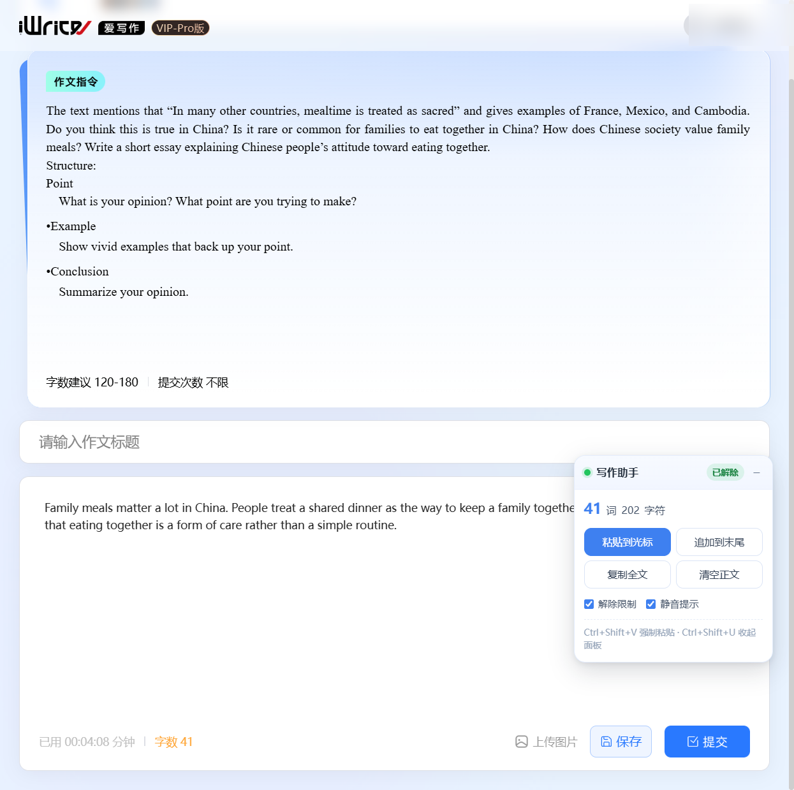

# iWrite 粘贴解锁 Pro

[](CHANGELOG.md)
[](LICENSE)
[]()

<p align="left">
  <a href="https://github.com/Phiedeir/iwrite-paste-unlock/raw/main/iwrite-paste-unlock-pro.user.js">
    
  </a>
  <a href="https://github.com/Phiedeir/iwrite-paste-unlock/raw/main/iwrite-paste-unlock-pro.user.js">
    
  </a>
</p>

适配 **iWrite 爱写作（iwrite.unipus.cn）新版写作页** 的用户脚本：解除「该作业不允许复制粘贴 / 该作业不允许拖入内容」的限制，并附带一个与站点新 UI 视觉风格一致的悬浮工具面板。

> 老版脚本 [`XKScript/iWrite写作平台解除粘贴限制.js`](https://github.com/MagicMonkey-XK/XKScript) 依赖百度 UEditor 的 `beforepaste` 接口，站点改版后接口不存在，脚本静默失效。本项目是**重新实现**，不是打补丁。



## 为什么旧脚本失效了

iWrite 新版前端已整体重写为 **UmiJS（React）+ Ant Design**（静态资源 `/newfe/umi.js`，约 5.5 MB），写作页 `/student/daily/write` 的编辑器从 UEditor 换成了 antd `<TextArea>`，限制逻辑写在 React 的合成事件里：

```js
// umi.js 中写作页组件（已反混淆还原）
ht = null != $e && 0 === Number($e.copy);   // 服务端下发的开关：copy === 0 即禁止
bt = e => { ht && (e.preventDefault(), message.warning('该作业不允许复制粘贴')) };  // onPaste
yt = e => { ht && (e.preventDefault(), message.warning('该作业不允许拖入内容')) };  // onDrop
jt = e => { ht && e.preventDefault() };                                            // onDragOver
```

`UE.getEditor` 在新版根本不存在，所以老脚本无从下手。完整分析见 [docs/analysis.md](docs/analysis.md)。

## 原理

不硬改闭包里的 `ht`（改不到），也不去篡改接口响应，而是**在事件原型层放行这几类事件的 `preventDefault`**：

```js
const ALLOW = new Set(['paste', 'drop', 'dragover', 'dragenter', 'beforeinput']);
const raw = Event.prototype.preventDefault;
Event.prototype.preventDefault = function () {
  if (ALLOW.has(String(this.type || '').toLowerCase())) return;  // 不阻止默认行为
  return raw.apply(this, arguments);
};
```

浏览器恢复默认粘贴行为 → 文本插入 → 触发 `input` → React 的 `onChange` 拿到新值 → 受控 state 正常更新。整条链路已在真机验证（受控组件不会被 React 回写成空）：

| 检查项 | 结果 |
| --- | --- |
| 真实 `Ctrl+V` 后 DOM 值 | `0 → 202` 字符 |
| React fiber `memoizedState` 中的正文字符串 | `len = 202`（与 DOM 一致） |
| 站点提示「该作业不允许复制粘贴」 | 已弹出，被脚本静音（`display:none`） |
| 面板词数 / 站点「字数」 | `41 / 41`（口径一致） |

详见 [docs/verification.md](docs/verification.md)。

## 功能

- **解除粘贴 / 拖拽限制**：Ctrl+V、右键粘贴、拖入文本、拖入文件全部放行
- **静音站点提示**：隐藏「该作业不允许复制粘贴 / 拖入内容」的 antd message，不再打断写作
- **悬浮工具面板**（默认收起成小胶囊，可拖拽、可记忆位置）：
  - 状态点 + `已解除 / 原始限制` 徽标，一键切回站点原始限制（方便对照测试）
  - 实时 `词 / 字符` 统计，口径与站点「字数」一致
  - `粘贴到光标`、`追加到末尾`、`复制全文`、`清空正文`（走原生 value setter + `input` 事件，写入能进 React state，不是只改显示）
- **快捷键**：`Ctrl+Shift+V` 强制粘贴（连剪贴板 API 都拿不到时兜底）、`Ctrl+Shift+U` 收起 / 展开面板
- **SPA 兼容**：路由切换、组件重渲染后自动重新定位编辑器；非写作页自动隐藏面板
- **旧版兼容**：若命中旧版 `/student/toSubmitTask` 页面，仍会挂 UEditor 的 `beforepaste` 钩子

## 一键安装

| 脚本管理器 | 直装（点击后由管理器接管） | 还没装？先装扩展 |
| --- | --- | --- |
| **Tampermonkey（油猴）** | [**▶ 点这里安装脚本**](https://github.com/Phiedeir/iwrite-paste-unlock/raw/main/iwrite-paste-unlock-pro.user.js) | [Chrome](https://chromewebstore.google.com/detail/tampermonkey/dhdgffkkebhmkfjojejmpbldmpobfkfo) · [Edge](https://microsoftedge.microsoft.com/addons/detail/iikmkjmpaadaobahmlepeloendndfphd) · [Firefox](https://addons.mozilla.org/firefox/addon/tampermonkey/) |
| **ScriptCat（脚本猫）** | [**▶ 点这里安装脚本**](https://github.com/Phiedeir/iwrite-paste-unlock/raw/main/iwrite-paste-unlock-pro.user.js) | [Chrome](https://chromewebstore.google.com/detail/scriptcat/ndcooeababalnlpkfedmmbbbgkljhpjf) · [Edge](https://microsoftedge.microsoft.com/addons/detail/liilgpjgabokdklappibcjfablkpcekh) · [Firefox](https://addons.mozilla.org/zh-CN/firefox/addon/scriptcat/) |

**流程**：点「点这里安装脚本」→ 浏览器下载 `iwrite-paste-unlock-pro.user.js` → 脚本管理器弹出安装页 → 点「安装」→ **刷新写作页**。

> ⚠️ 必须刷新页面。脚本是 `@run-at document-start`，要在页面自身 JS 之前改写 `Event.prototype` 才能生效；已打开的旧标签页不会自动加载。

### 点击后没弹安装页？

| 现象 | 原因 / 处理 |
| --- | --- |
| 浏览器直接把脚本当文本显示 | 管理器没接管这个 URL。确认扩展已启用；ScriptCat 需在设置里允许安装用户脚本 |
| 两个管理器都装了，只有一个接管 | 正常。浏览器只会让一个处理 `.user.js`，装一个就够 |
| 装完没反应 | 没刷新页面，或者装在了别的浏览器配置里（检查扩展当前 Profile） |
| 公司/校园网拦截 GitHub | 用 jsDelivr 备用直链：`https://cdn.jsdelivr.net/gh/Phiedeir/iwrite-paste-unlock@main/iwrite-paste-unlock-pro.user.js` |

### 手动方式

**Tampermonkey**：面板 →「添加新脚本」→ 清空模板 → 粘贴 [`iwrite-paste-unlock-pro.user.js`](iwrite-paste-unlock-pro.user.js) 全文 → 保存 → 刷新页面。

**ScriptCat**：面板 →「新建脚本」→ 粘贴同一份内容 → 保存 → 刷新页面。

### 控制台临时版（不装扩展）

打开写作页 → `F12` → Console → 粘贴 [`iwrite-unlock-console.js`](iwrite-unlock-console.js) 全文回车。立即生效，**刷新后失效**，需要重新执行。

## 使用

- 面板默认贴在编辑器右下角，折叠成 `● 写作助手 +` 的小胶囊；点 `+` 展开，拖动标题栏可换位置（位置存在 `localStorage`）
- 页面里有作文输入框才显示面板；离开写作页自动隐藏
- `解除限制` 取消勾选 = 恢复站点原始行为，用于对比验证
- 粘贴后若正文有明显格式问题（例如从 Word 带样式），属于浏览器默认粘贴行为，不在脚本职责内

## 兼容性

| 项目 | 说明 |
| --- | --- |
| 目标站点 | `https://iwrite.unipus.cn/*`（学生端写作页 `/student/daily/write`、旧版 `/student/toSubmitTask`） |
| 浏览器 | Chrome / Edge 等 Chromium 内核；Firefox + Tampermonkey 同样适用 |
| 脚本管理器 | Tampermonkey / Violentmonkey（`@grant none`，运行于页面上下文，这是能改到 `Event.prototype` 的前提） |
| 依赖 | 无。不依赖 jQuery |

## 已知限制

- **必须刷新页面**才生效；已打开的旧标签页需要重新加载
- 只放开**客户端 UI 层**的限制。服务端下发的 `copy` 字段、提交记录里的写作时长等数据仍按站点逻辑走，脚本不篡改任何请求/响应内容
- 站点前端改版（类名、编辑器结构变化）可能导致**面板拉不到输入框**。脚本已用 `placeholder` 关键词 + 尺寸兜底做多重匹配，但极端改版仍需更新选择器。粘贴解锁本身走事件原型，不依赖选择器，通常不受影响
- 面板词数按空白分词统计，与站点口径一致；纯中文输入时两者都会显示接近 1 的「词」数，这是站点本身的统计方式

## 目录结构

```
iwrite-paste-unlock/
├── iwrite-paste-unlock-pro.user.js   # 主脚本（Tampermonkey）
├── iwrite-unlock-console.js          # 控制台临时版
├── docs/
│   ├── analysis.md                   # 新版前端限制实现分析（含定位方法）
│   └── verification.md               # 端到端验证记录
├── screenshots/
│   ├── panel-expanded.png
│   └── panel-collapsed.png
├── CHANGELOG.md
└── LICENSE
```

## 致谢

- 思路起点：[MagicMonkey-XK/XKScript](https://github.com/MagicMonkey-XK/XKScript)（老版 UEditor 方案的作者）
- 新版限制实现的分析、绕过路径与 UI 重做在本仓库完成

## License

[GPL-3.0-or-later](LICENSE)（SPDX: `GPL-3.0-or-later`）。简单说：可以自由使用、修改、再分发，但**修改后的版本也必须以 GPL 开源**，不能打包成闭源/收费软件分发。

选它的原因：

1. **与上游对齐** —— 本项目源自 [MagicMonkey-XK/XKScript](https://github.com/MagicMonkey-XK/XKScript) 的思路，上游脚本头声明 `GPL`，同族许可避免任何兼容性争议
2. **用户脚本场景下几乎零成本** —— GPL 要求分发时附带源码，而用户脚本本身就是明文源码，等于没有额外义务
3. **挡住「打包卖钱」** —— MIT 允许他人闭源转售，GPL 不允许；这类工具被二次包装成付费软件的情况很常见
4. **被脚本站接受** —— Greasyfork / ScriptCat 都接受 GPL-3.0